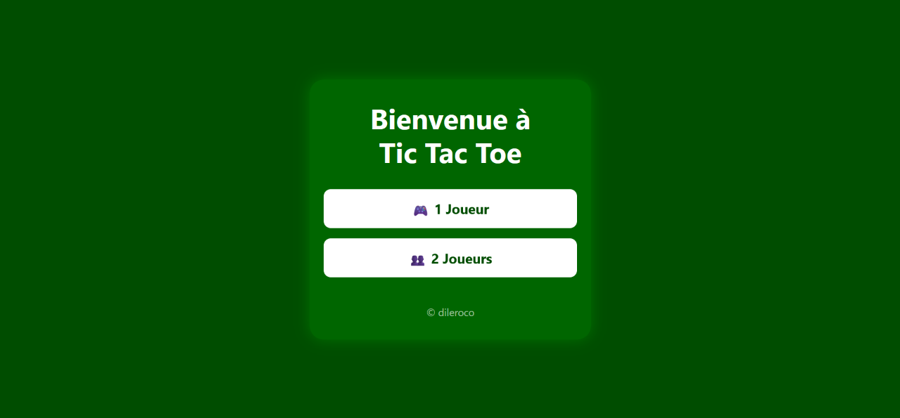
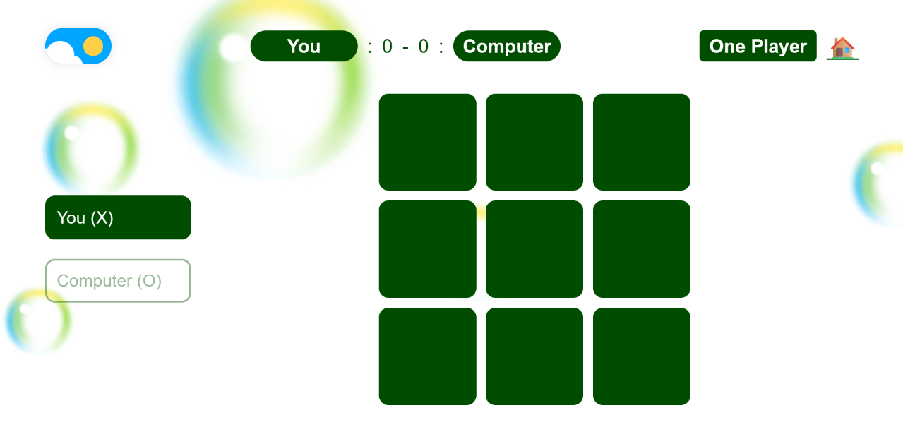
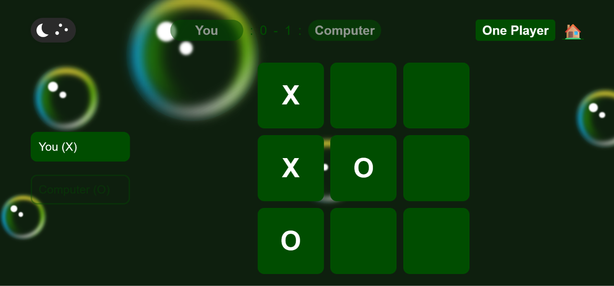
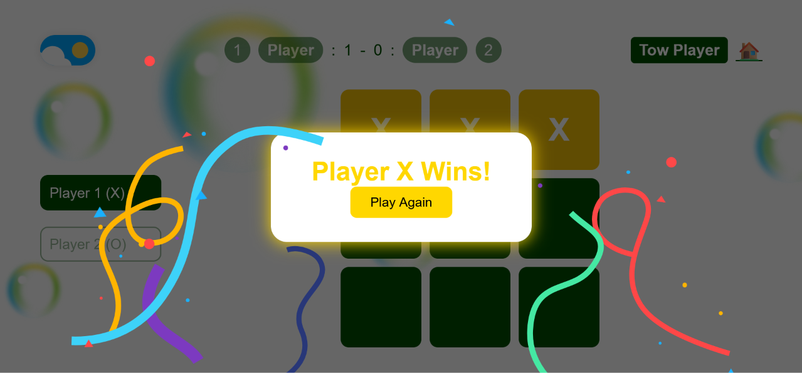

# Tic-Tac-Toe Game

Tic-Tac-Toe game built with HTML, CSS, and JavaScript.

## Screenshots

## Features

- **Two-Player Mode:** Play against another player on the same device.
- **One-Player Mode:** Play against the computer using a rule-based strategy.
- **Winner Detection:** Automatically detects winning combinations.
- **Draw Detection:** Detects when the board is full without a winner.

## Technologies Used

- HTML5
- CSS3
- JavaScript

## Project Structure

- `tictactoe/welcomepg/` – Welcome page.
- `tictactoe/onemode/` – One-player game.
- `tictactoe/towmode/` – Two-player game.

## How to Run

1. Clone the repository.
2. Open the project folder.
3. Open `tictactoe/welcomepg/index.html` in your browser.
4. Choose your preferred game mode and start playing.